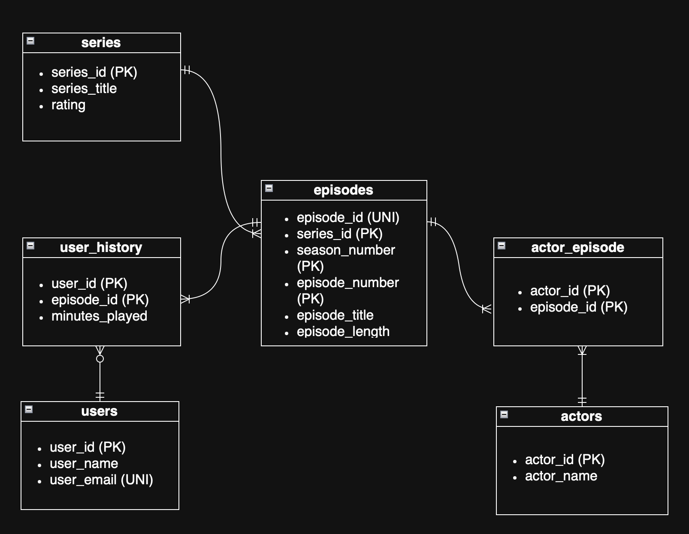

# TV Series Database Management System

## Project Overview

A relational database management system developed as part of my Master's coursework at the University of Limerick.

This project focuses on managing TV series, episodes, actors, users and viewing history using MySQL.

## Database Design

The database consists of six tables:

- **series** – Stores TV series details and ratings.
- **episodes** – Stores episode information, including season and episode numbers.
- **users** – Stores user information.
- **user_history** – Tracks users' episode-watching activity.
- **actors** – Stores actor information.
- **actor_episode** – Establishes relationships between actors and episodes.

## Entity Relationship Diagram

## SQL Concepts Implemented

- SQL Joins
- Aggregate Functions
- Views
- Triggers
- Stored Procedures
- User-defined Functions

## Key Implementations

| SQL Object | Description |
|---|---|
| top_series_cast | Displays actors in highly rated series |
| actor_minutes | Calculates total viewing minutes associated with actors |
| AdjustRating | Adjusts viewing minutes and series ratings |
| AddEpisode | Adds episodes while checking for duplicates |
| GetEpisodeList | Returns episode titles for a selected season |

## Technologies Used

- MySQL
- PHP / XAMPP
- Windows 11

## Learning Outcomes

- Relational database design
- Database relationships and constraints
- Advanced SQL programming
- Database automation using triggers and procedures
- Data aggregation and manipulation

## Academic Context

**Module:** CS6401 – Database Systems in Practice  
**University:** University of Limerick

This project was completed as part of Master's coursework.
